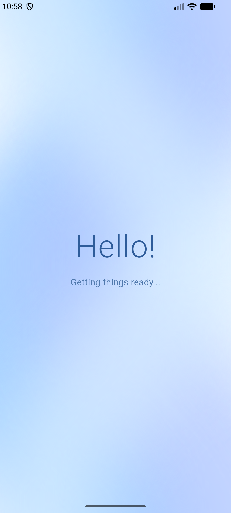
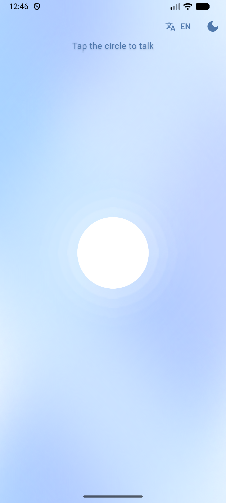
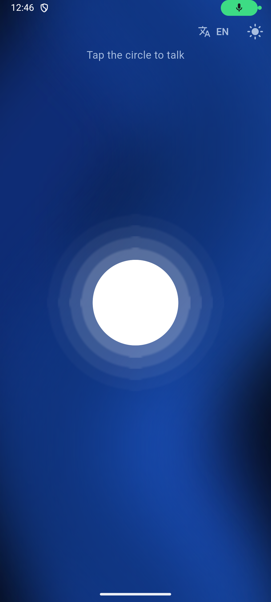
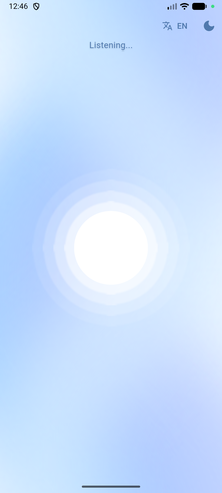
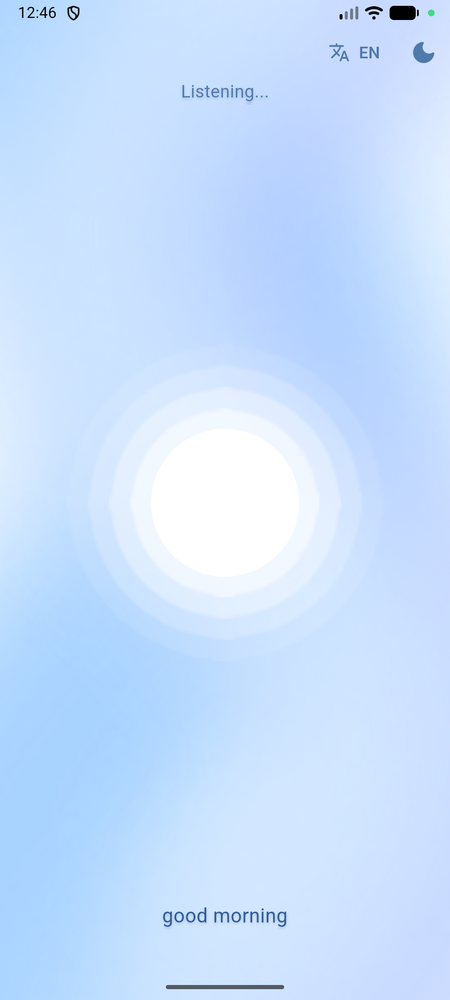

# Alan - AI Assistant Home Screen

The home screen of the Alan AI assistant app, built with Flutter. It greets the user, then shows a voice-reactive circle: tap it, speak, and the circle responds to your voice while your words appear as text.

This is the first part of the graduation project. It is a self-contained screen, ready to be connected to the backend.

## Features

- **Greeting screen:** a soft "Hello!" fades in while the app gets ready, then moves to the home screen.
- **Flowing background:** slow, S-shaped bands of blue that curve and drift across the screen.
- **Voice-reactive circle:** a white circle with soft rings. It stays still until you tap it. While listening, the rings fade in and spread outward with the volume of your voice.
- **Speech to text:** what you say is shown live at the bottom of the screen.
- **English and Arabic:** an EN/AR button switches the language the app listens in. The screen text switches too. Arabic needs Arabic voice input installed on the phone.
- **Light and dark mode:** a moon/sun button in the top corner switches modes. It starts from the phone's own setting.

## Screenshots

| Greeting | Home (light) | Home (dark) | Listening | Speech-to-Text
| --- | --- | --- | --- |
|  |  |  |  |  |

## Built with

- [Flutter](https://flutter.dev) and Dart
- [`speech_to_text`](https://pub.dev/packages/speech_to_text) for speech recognition

## Project structure

```
lib/
  main.dart                 App entry point and light/dark theme switching
  app_colors.dart           Color palettes for light and dark mode
  flowing_background.dart   The animated S-shaped gradient background
  splash_screen.dart        The "Hello!" greeting screen
  home_screen.dart          The circle, rings and speech input
```

## Getting started

### Requirements

- Flutter SDK installed (check with `flutter doctor`)
- An Android phone with USB debugging on, or an Android emulator
- Windows only: Developer Mode turned on in Windows settings (Flutter needs it for plugins)

### Run the app

```bash
git clone <repository-link>
cd <project-folder>
flutter pub get
flutter run
```

Allow the microphone when the app asks. Then tap the circle and speak.

### Build an APK

```bash
flutter build apk
```

The file is created at `build/app/outputs/flutter-apk/app-release.apk`.

### Permissions

The Android permissions are already set in `android/app/src/main/AndroidManifest.xml`:

- `RECORD_AUDIO` to hear the user
- `INTERNET` because Android speech recognition often needs a connection
- A `<queries>` entry for `android.speech.RecognitionService`

iOS is not set up yet. It would also need microphone and speech recognition descriptions in `Info.plist`.

## Connecting the backend

The recognized speech is stored in one variable, `recognizedText`, in `lib/home_screen.dart` (inside `_HomeScreenState`). It updates live while the user speaks.

To send the text to a backend, take the value of `recognizedText` when listening stops. A good place for this is the `onStatus` callback inside `_initSpeech()`, when the status is `done`. No other part of the screen needs to change.

## Customizing

| What | Where |
| --- | --- |
| Colors for light and dark mode | `lib/app_colors.dart` |
| How long "Hello!" stays on screen | `3200` (milliseconds) in `lib/splash_screen.dart` |
| Speed of the flowing background | `seconds: 14` in `lib/flowing_background.dart` (bigger is slower) |
| How curvy the S shape is | `0.30` in `lib/flowing_background.dart` |
| Circle size and ring transparency | `core` and `ringAlpha` in `lib/home_screen.dart` |

## Known limitations

- Microphone input often does not work on emulators. Test speech on a real phone.
- Speech recognition on Android usually needs an internet connection and Google's speech services on the device.
- Arabic recognition only works if Arabic voice input is installed on the phone. Otherwise the EN/AR button shows a message.

## Status

- [x] Home screen design
- [x] Speech to text
- [x] Light and dark mode
- [ ] Connect to the backend
- [ ] Other screens of the app
